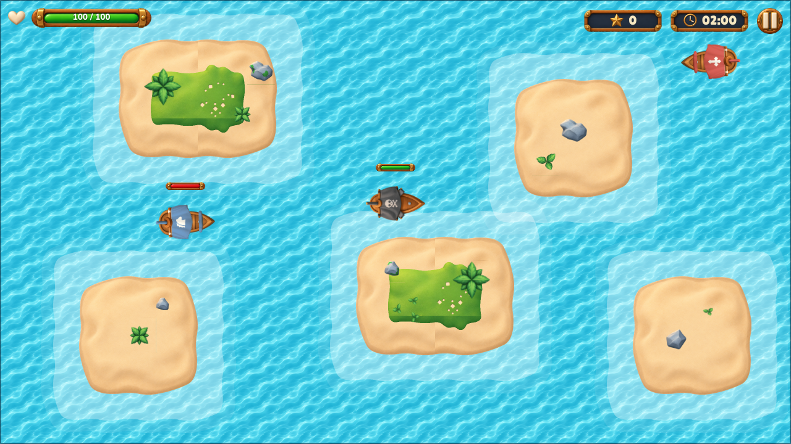

# Pirate Battle

A top-down naval shooter built with **React, TypeScript (strict), PixiJS, TanStack Query, Axios, MSW and
Playwright**. Sail between islands, sink enemy ships and climb the ranking before the clock runs out.

**Live demo:** _(deployment URL)_



- [Architecture and design decisions](ARCHITECTURE.md)
- [Performance report](perf-results/REPORT.md)
- [E2E HTML report of the delivered build](reports/e2e-html/index.html) (open with `npx playwright show-report reports/e2e-html`)
- [Asset and font credits](CREDITS.md)

## Quick start

Requirements: **Node.js 22.12+** and npm.

```bash
npm ci
npm run dev            # http://localhost:5173
```

The ranking/history API is mocked with MSW in every environment (dev, tests and the deployed build), so no
backend or environment variables are needed.

## Commands

| Command | What it does |
| --- | --- |
| `npm run dev` | Development server with hot reload |
| `npm run build` | Type-check (`tsc -b`) and production build to `dist/` |
| `npm run preview` | Serve the production build on http://localhost:4173 |
| `npm run lint` | Lint with oxlint (warnings fail) |
| `npm run typecheck` | TypeScript project build in strict mode |
| `npm test` | Unit tests of the simulation (Vitest) |
| `npm run test:e2e` | Playwright E2E suite (builds and serves the production bundle) |
| `npm run test:e2e:ui` | Playwright UI mode |
| `npm run test:e2e:update` | Regenerate visual baselines |
| `npm run test:e2e:report` | Open the last HTML report |
| `npm run perf` | 3-minute profiling match + 5 memory cycles → `perf-results/` |
| `npm run assets` | Regenerate `public/assets` from the original pack in `assets/` (needs ffmpeg) |

## Environment variables

All optional (see `.env.example`):

| Variable | Default | Purpose |
| --- | --- | --- |
| `VITE_API_BASE_URL` | `/api` | Base URL of the ranking/history API |
| `VITE_API_TIMEOUT_MS` | `8000` | Axios timeout |
| `VITE_ENABLE_MOCKS` | `true` | Set `false` to disable MSW |

## Controls

| Action | Keyboard | Touch |
| --- | --- | --- |
| Sail forward | `W` / `↑` | ⬆ button (left pad) |
| Turn left / right | `A` `D` / `←` `→` | ↶ ↷ buttons (left pad) |
| Front cannon (1 shot) | `Space` / `K` | middle cannon (right pad) |
| Left broadside (3 shots) | `Q` / `J` | left cannons (right pad) |
| Right broadside (3 shots) | `E` / `L` | right cannons (right pad) |
| Pause / resume | `Esc` / `P`, pause button | pause button |

Hold a fire key to keep shooting (each cannon has its own reload time); sailing and firing work at the same
time, and touch buttons support multi-touch. The game pauses automatically when the window loses focus or
the tab is hidden; resuming always needs the Resume button. Game keys are only captured during a running
match.

**Mobile:** landscape is the supported orientation. In portrait the match pauses and asks you to rotate;
menus work in both orientations. On-screen controls appear on touch devices (or with `?touch=1`).

## Gameplay configuration

All balancing values are in [`src/game/config/gameConfig.ts`](src/game/config/gameConfig.ts) (speeds, turn
rates, health, damage, ranges, projectile speed/lifetime, cooldowns, Shooter range, spawn distance,
enemy weights, max enemies…). Systems only read this typed config, so tuning never touches system logic.

The Options screen exposes two values, validated and persisted in localStorage:

| Option | Range | Default |
| --- | --- | --- |
| Game session time | 60–180 s, step 10 s | 120 s |
| Enemy spawn time | 1–10 s, step 0.5 s | 3 s |

Each match takes a frozen snapshot of the configuration when it starts; changing Options affects the next
match only. The ranking compares only matches played with the same rules (session time, spawn time and
balance version).

## Network scenarios (MSW)

Open **Network lab** (bottom-left button on every menu screen) to pick a scenario, **Reset mock server**
(restores fixtures and the Normal scenario) or **Clear local results**. The same can be done through the URL:

| Parameter | Effect |
| --- | --- |
| `?scenario=<id>` | Select a scenario (persisted until changed) |
| `?mockSeed=<n>` | Seed for random latency |
| `?mockLatency=<ms>` | Fixed latency for the Normal scenario |
| `?apiTimeout=<ms>` | Client timeout (shorter timeouts make timeout scenarios faster) |

| Scenario id | Behaviour |
| --- | --- |
| `normal` | Success, ~120–380 ms seeded latency |
| `empty` | Empty ranking and history |
| `many-pages` | 120 extra captains in the ranking |
| `slow` | 2.5 s for every response |
| `variable-latency` | Seeded 0.1–3 s latency |
| `out-of-order` | Odd GETs slow, even GETs fast (older responses arrive last) |
| `timeout` | Never answers (client times out) |
| `network-error` | Connection failure |
| `server-error` | HTTP 500 everywhere |
| `client-error` | HTTP 400/422 |
| `ranking-down` / `history-down` | Only one endpoint fails |
| `submit-timeout-after-save` | First submit is stored but its response is lost; the retry returns the stored record |
| `submit-unavailable` | Submitting a match fails (503) until another scenario is chosen |

### Reproducing failures

* **Pending record after refresh:** open `/?scenario=submit-unavailable`, play a match (use 60 s), see
  *Not saved yet* on the Result screen, reload — the record is still in Match History as pending. Choose
  *Normal* in Network lab (or open `/?scenario=normal`): it is sent automatically and appears once.
* **Timeout after save without duplicates:** `/?scenario=submit-timeout-after-save&apiTimeout=1500`, finish
  a match: the client times out, retries and receives the existing record; History shows a single entry.
* **Loading / errors:** `/?scenario=slow#/log/ranking`, `/?scenario=ranking-down#/log/ranking`.

## Tests

### Unit (Vitest)

`npm test` runs `src/game/core/__tests__`: time-based movement, borders and islands, cooldowns, broadsides,
scoring once, Chaser ramming, Chaser going around an island, Shooter fire, spawn interval and both kinds,
end of match freeze, determinism per seed.

### End-to-end (Playwright)

```bash
npx playwright install chromium   # once
npm run test:e2e
```

* Runs against the **production build** served by `vite preview` (started automatically).
* Projects: `desktop-chromium` (1280×720, all tests) and `mobile-chromium` (Pixel 7 landscape, touch) for the
  main flows tagged `@mobile`, including multi-touch controls.
* Every test starts from a fresh browser context (isolated storage, service worker and mock database) and
  fails on unexpected console errors.
* Determinism: `?seed=` fixes the match RNG, `?clock=manual` puts the simulation under test control from frame
  zero, `?spawning=0` disables automatic spawns. The `?e2e=1` bridge (`window.__pirate`) can read state,
  advance the clock and place ships, but inputs are real key presses / touches and all rules, collisions and
  rendering run through the real code.
* Reports: HTML report in `playwright-report/`, traces (and videos) kept for failures in `test-results/`.
* Visual regression: `e2e/__screenshots__` holds versioned baselines (menu, arena, result) generated on
  Linux/Chromium. Screenshot assertions are skipped on other OSes (font rasterisation differs); force them
  with `PW_FORCE_SNAPSHOTS=1` or run inside the official Docker image:
  `docker run --rm -v $PWD:/w -w /w mcr.microsoft.com/playwright:v1.64.1-noble npm run test:e2e`.
* Optional: `PW_CHROMIUM_PATH=/path/to/chrome` uses a local Chromium, `PW_VIDEO=off` disables videos.

| # | Area | Spec |
| ---: | --- | --- |
| 1 | Options navigation, validation, persistence | `01-options` |
| 2 | Asset loading, failure and retry | `02-assets` |
| 3 | Start, movement, rotation, arena limits, islands | `03-movement` |
| 4 | Front/broadside fire, damage, cooldown, score once | `04-combat` |
| 5 | Chaser, Shooter, spawn interval | `05-enemies` |
| 6 | End by time / death, freeze, clean restart | `06-end` |
| 7 | Pause, focus loss, resume without leaks | `07-pause` |
| 8 | Result screen and refresh | `08-result` |
| 9 | Abandon, repeated navigation, touch controls | `09-navigation` |
| 10 | Ranking / History, pagination, loading, empty, error | `10-log` |
| 11 | Recording, both tabs updated, pending after refresh | `11-submit` |
| 12 | Timeout without duplicates, repeated clicks, late responses | `12-resilience` |
| — | Visual regression | `13-visual` |

## Performance

`npm run perf` plays a full 3-minute match at the heaviest spawn rate with an invulnerable bot, records frame
times (average FPS, p95/p99), entity counts, and the JS heap / DOM / listeners / canvases after five
start-play-exit cycles. Results and the reference environment are in
[`perf-results/REPORT.md`](perf-results/REPORT.md). Run it headed on your machine (`PW_HEADED=1 npm run perf`)
for GPU numbers.

## Project structure

```
src/
  game/
    config/      typed gameplay configuration
    core/        pure simulation (world, systems, math, rng) + unit tests
    render/      PixiJS renderer, views, effects, asset loading
    input/       keyboard + touch input
    audio/       sound effects
    session/     GameSession (loop, pause, HUD store), test bridge
  api/           contracts (Zod), Axios client, TanStack Query hooks, submission outbox
  mocks/         MSW handlers, persisted mock db, fixtures, scenarios
  app/           hash router, persistence stores
  ui/            React screens, HUD, dialogs
e2e/             Playwright specs and visual baselines
e2e-perf/        profiling run
assets/          original asset pack (source)
public/assets/   optimized runtime assets (generated by scripts/prepare-assets.mjs)
```

## Deployment

Static build (`npm run build` → `dist/`). The deployed demo includes the MSW worker and runs the mocked API.
On Vercel: framework preset *Vite*, build command `npm run build`, output `dist`.
